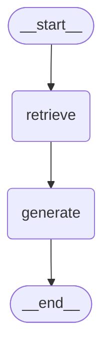

# 검증 결과 — MLB 기록 랩

> AI 코어 프로젝트 2회차 · 명세서 4장 확인 항목별 실행 결과 · 실행일 2026-10-22
> 표기: ✅ 통과 · ❌ 실패 · ⏳ 미확인. 화면 캡처는 `docs/images/verify/`.
> 실행 환경: 색인 `player_meta` 2,047 · `player_docs` 86,407(검증 중 질문 시 수집으로 86,482), 채팅 `gpt-5.4-mini`, 임베딩 `text-embedding-3-large`, Django DEBUG 꺼짐
> 코드 경로는 `src/` 기준 (예: `rag/graph.py` = `src/rag/graph.py`), 데이터는 프로젝트 루트의 `data/`.

---

## 4.1 데이터와 색인 확인 (F2001 ~ F2002)

| 확인 항목 | 결과 | 근거 |
|---|---|---|
| 로드한 항목 수와 색인된 청크 수가 일치 | ✅ | `players.json` 2,047명 = `player_meta` 2,047건 (`/api/status`: `players 2047 · index_meta 2047`) |
| 색인을 두 번 실행해도 청크 수가 늘지 않음 | ✅ | `python -m rag.indexer --players ryuhy01,troutmi01` 2회 → 두 번 모두 "새로 쓰기 0 · 임베딩 0", 전체 건수 2,047 / 86,407 그대로 |
| 항목 1건의 색인 텍스트에 의도한 속성이 모두 있음 | ✅ | 아래 출력 — 이름(한/영) · 투타 · 포지션 · 출생 · 출신 · 활약 기간 · 소속 · 통산 기록 · 최고 시즌 · 수상 · 올스타 · 포스트시즌 · 특징 |

```text
류현진 (Hyun-jin Ryu) · 좌투우타 선발투수 · 1987년생 · 출신 대한민국
MLB 2013~2023 시즌 · 소속: 로스앤젤레스 다저스, 토론토 블루제이스
통산 투구(1901~2025 범위): 78승 48패 1세이브 · 1055⅓이닝 · 평균자책점 3.27 · ERA+ 130 · FIP 3.52 · WHIP 1.18 · 탈삼진 934
최고 시즌: 2019 (14승 5패, 평균자책점 2.32, ERA+ 178)
수상: 2019 올-MLB 세컨드 팀, 2020 올-MLB 세컨드 팀
올스타 선정 1회 (2019)
포스트시즌: 2013 내셔널리그 챔피언십시리즈 진출, 2014 내셔널리그 디비전시리즈 진출, 2018 월드시리즈 진출, …
특징: 볼넷이 적은 제구형 투수 (볼넷 비율 6% 이하), 리그 평균보다 크게 뛰어난 실점 억제 (통산 ERA+ 120 이상)
```

## 4.2 문서 수집과 색인 확인 (F2003 ~ F2005)

| 확인 항목 | 결과 | 근거 |
|---|---|---|
| 프롬프트 1이 뽑은 검색어 목록 | ✅ | 류현진 "2019년 평균자책점과 FIP 차이는 왜 생겼어?" → `Hyun-jin Ryu 2019 season ERA FIP Toronto Blue Jays` · `Hyun-jin Ryu 2019 advanced pitching statistics` · `류현진 2019 평균자책점 FIP` (화면 진행 상태 첫 줄, 캡처 `4-3_answer_sources.png`) |
| 프롬프트 2로 색인된 문서와 버려진 문서 구분 | ✅ | 지터 "2001년 월드시리즈 상대 애리조나는 어떤 팀?" → 새 검색어 2 · 후보 6 · **선별 2건** (2001 Arizona Diamondbacks season · 2001 World Series), 나머지는 `wiki_manifest.json`의 `rejected`에 제목 · 검색어와 함께 기록. 류현진 "좋아하는 음식" → 후보 5~9 · **선별 0건** (관련 없는 후보 전부 버림) |
| 같은 질문을 다시 물었을 때 수집이 다시 일어나지 않음 | ✅ | 같은 지터 질문 3번째 → 진행 상태에 "문서 수집" 단계 없음, 앞서 수집한 두 문서를 근거로 인용 [6, 7]. manifest에 `q:en:2001 arizona diamondbacks season` 등 검색어 기록 |
| 선택한 항목 자체 문서가 빠지지 않음 | ✅ | 항목 2,047명 전원 본인 한/영 위키 문서를 사전 수집 · 색인 (선별 없이 항상). 위 질문들의 근거에도 본인 문서(Derek Jeter · Hyun-jin Ryu) 포함 |
| 청크 크기 · 겹침을 바꾸면 청크 수가 달라짐 | ✅ | 위키 문서 4,105건 전체: **500/100 → 85,303 · 1000/200 → 41,980 (본 색인과 일치) · 2000/300 → 20,382**. 선수 1명(류현진) RAG 실험실: 1000/200 43개 · 500/100 92개 |

## 4.3 답변과 근거 확인 (F2006 ~ F2008)

| 확인 항목 | 결과 | 근거 |
|---|---|---|
| Top-k를 바꾸면 근거 목록이 달라짐 | ✅ | RAG 실험실 류현진 "플레이 스타일과 주무기는?" — 위키 Top-k 4: 위키 근거 4개(한화 · 플레이 스타일 · 첫 문단 · 성장기) / Top-k 2: 앞의 2개만. 근거 수 8 → 6 |
| LangGraph가 retrieve · generate 두 노드 | ✅ | `python -m scripts.ask --graph` 출력 (아래) |
| 답변의 근거 번호와 화면 근거 목록이 일치 | ✅ | 답변의 [근거 2] [근거 10] [근거 11] = 화면 "근거 3건"의 [2] 기록 데이터 · [10] [11] 지표 사전 (캡처 `4-3_answer_sources.png`). API `cited` = [2, 10, 11] |
| 근거 목록에 메타데이터와 외부 문서가 구분 표시 | ✅ | 근거마다 출처 유형 표시: 메타데이터 / 기록 데이터(Lahman) / 영어 · 한국어 위키백과 / 지표 사전 |
| 문서에 없는 것은 추측하지 않고 "확인되지 않는다" | ✅ | 류현진 "가장 좋아하는 음식" → "근거 자료에서 류현진이 가장 좋아하는 음식은 확인되지 않는다." (캡처 `4-3_unknown.png`) |
| 인용 근거가 0개면 화면에 안내 | ✅ | 같은 답변 아래 "답변에 인용된 근거가 없습니다." |



## 4.4 서비스 기능과 화면 확인 (F2009 ~ F2012)

| 확인 항목 | 결과 | 근거 |
|---|---|---|
| 항목을 바꿨을 때 이전 대화가 섞이지 않음 | ✅ | 류현진에게 질문 → 커쇼 페이지: 대화 비어 있음 → 류현진으로 돌아오면 이전 대화 그대로 (캡처 `4-4_history_ryu.png` · `4-4_history_kershaw.png` · `4-4_history_ryu_again.png`). 대화는 선수(비교는 선수 조합)별 키 `mlb-lab:{선수}|{비교 선수}`로 저장 |
| 조건 탐색 결과에 조건과 맞지 않는 항목이 섞이지 않음 | ✅ | "통산 홈런 500개 이상인 우타자" 15명 · "통산 세이브 300개 이상" 17명 · "사이영상을 받은 좌투수" 22명 — 모두 `players.json`과 대조해 **정밀도 · 재현율 100%** (캡처 `4-4_explore.png`). 아래 "발견한 문제 1" 참고 |
| 도메인 특화 기능 결과에도 근거 제시 | ✅ | 비교: 류현진 vs 커쇼 2019 — 항목별 "A 값 [근거 2] / B 값 [근거 9]" (`4-4_compare.png`). 사실 확인: "트라웃은 2016년에 홈런 50개를 쳤다" → 판정 거짓, 29개 [근거 2] (`4-4_factcheck.png`), "2016년 MVP" → 판정 참 [근거 2][근거 7]. 구단 시절 합산: 푸홀스 카디널스 시절 홈런 469개 [근거 5 · 시절 합산] (`4-4_team_era.png`) |
| 문서 수집 · 답변 생성 중 진행 상태 표시 | ✅ | 처리 중 표시 → 근거 목록 먼저(스트리밍) → 완료 후 "검색어 · 문서 수집(새 검색어 · 후보 · 선별) · 출처별 근거 수 · 소요 시간" (모든 답변 캡처 상단 회색 줄) |
| 색인 없음 · 키 없음 상태에서 안내 | ✅ | 키 없음: 모드 "기록 검색" + "GMS 키가 없어 기록 검색 모드(LLM 미사용)로 답합니다…", 질문에는 2019 기록 문서로 답함 (`4-4_nokey.png`). 색인 없음: "색인이 비어 있어 기록 검색 모드로 답합니다. python -m rag.indexer --all 을 실행하세요." · 색인 0건 표시 (`4-4_noindex.png`). 검증용 임시 서버로 실행, 프로젝트 파일 · 본 색인은 그대로 |
| 위험 도메인 면책 안내 | ➖ | 해당 없음 (야구 기록은 건강 · 금융 같은 위험 도메인이 아님) |

## 4.5 심화 기능 확인 (F2013 ~ F2016)

| 확인 항목 | 결과 | 근거 |
|---|---|---|
| F2013 — HTML · CSS · JS로 동작, 질문 · 답변 · 근거 표시 | ✅ | Django 템플릿 + `style.css` · `ask.js` 등, 화면과 JSON API 분리 (`/api/status` · `players` · `ask` · `ask_stream` · `explore` · `lab`). 메인 `4-5_home.png`, 질문 · 답변 · 근거 `4-3_answer_sources.png` |
| F2014 — 유사도 검색과 MMR의 근거 차이 | ✅ | 오타니 "투타 겸업 경력과 기록": 위키 근거끼리 평균 유사도 **0.785 → 0.722** (실험실, `4-5_lab_mmr.png`), CLI 0.831 → 0.787 — 비슷한 시즌 투구 청크 대신 "50-50 클럽" 청크가 들어옴. 지터 "주장 시절 리더십" 0.741 → 0.688 ("2003~2008" 절 추가). 류현진 "한국과 미국에서의 경력"은 원래 근거가 다양해 변화 없음 |
| F2015 — RAG 사용 전후 답변을 나란히 확보 | ✅ | `docs/rag_comparison.md` (4.6) |
| F2016 — 근거 목록에 출처 종류 구분 표시 | ✅ | 한 답변에 기록 데이터(Lahman) · 영어 위키백과 · 지표 사전이 함께, 출처 유형 표시 (`4-3_answer_sources.png`) |

## 4.6 RAG 사용 전후 품질 비교

✅ `docs/rag_comparison.md` — 대표 질문 12개(5개 이상), 근거 없이 틀리기 쉬운 질문(덜 알려진 선수 시즌 기록 · 계산 지표 · 사건 날짜 · 근거 없는 질문)으로 구성. 사실 정확성 · 근거 제시 · 모르는 것을 모른다고 답하는지 세 기준으로 비교.

| 기준 | RAG 없이 | RAG |
|---|---|---|
| 사실 정확성 | ✅ 7 · 🟡 2 · ❌ 3 | ✅ 11 · ⭕ 1 |
| 근거 제시 | 0 / 12 | 11 / 11 |
| 모르는 것을 모른다고 | 지어냄 | "확인되지 않는다" |

## 4.7 비기능 요구사항 확인 (NF2001 ~ NF2007)

| 항목 | 결과 | 근거 |
|---|---|---|
| NF2001 대표 질문 처리 시간 | ✅ | 측정(10/22): 일반 질문 6~18초(비교 5.8 · 사실 확인 4.0~16.3 · ERA/FIP 12.2 · 구단 합산 17.9), 조건 탐색 0.2~0.9초(규칙) / 3~25초(LLM 판정). 근거 목록은 스트리밍으로 먼저 표시. **질문 시 보충 수집이 일어나는 질문은 41~46초** — 근거가 부족할 때만 수집 |
| NF2002 이미 수집한 검색어 재수집 안 함 | ✅ | 4.2 세 번째 질문 — 수집 단계 없음. manifest 검색어 · 문서 ID로 판단, 색인은 같은 청크 재임베딩 안 함(4.1) |
| NF2003 소스 · 제출물에 API 키 없음 | ✅ | 저장소 대상 파일 전체에서 키 패턴 · 연락처 검색 → 발견 없음. `src/.env` · `src/chroma_db/`는 `.gitignore`로 제외 (`git check-ignore` 확인), 저장소에는 `src/.env.sample`만 |
| NF2004 화면에 키 · 프롬프트 전문 · 오류 추적 정보 없음 | ✅ | 없는 주소 → 일반 404 페이지 (`4-7_404.png`). API 잘못된 요청 → `{"error": "요청 형식이 올바르지 않습니다."}` 400, 빈 질문 400, GET 405 — 모두 일반 문구. 응답에 프롬프트 · 키 없음. Django DEBUG 기본 꺼짐 |
| NF2005 모듈 분리 | ✅ | `collect/`(수집) · `build/`(정규화 · 지표 계산 · 한국어 표기) · `rag/indexer.py`(색인) · `rag/graph.py`(검색 · 생성) · `rag/prompts.py`(프롬프트) · `web/`(UI) |
| NF2006 재시도 · 호출 간격 · 식별 정보 | ✅ | 모든 위키 · Wikidata 호출 User-Agent에 연락처(`.env`), 요청 간 대기(Wikidata 0.3~1초 · 위키백과 0.4초), 429 · 5xx는 Retry-After를 따라 최대 4회 재시도 (`collect/04` · `rag/collector.py`). GMS(채팅 · 임베딩) 호출은 시간 제한 60초 · 일시 오류 재시도 3회 (`rag/config.py` `LLM_TIMEOUT` · `LLM_RETRIES`) |
| NF2007 출처 · 이용 조건 기록 | ✅ | README 5장(원천 · 가공 데이터별 라이선스), 화면 하단 출처 표기, 근거마다 원문 링크 |

---

## 요구사항 대조표

| 번호 | 요구사항 | 결과 | 확인 위치 |
|---|---|---|---|
| F2001 | 항목 메타데이터 로드 · 항목 1건 = 텍스트 1개 · 100건 이상 | ✅ | 4.1 |
| F2002 | 메타데이터 색인 · 건수 확인 · 재색인 중복 없음 | ✅ | 4.1 |
| F2003 | 프롬프트 1 검색어 추출 · 항목 자체 문서 항상 검색 | ✅ | 4.2 |
| F2004 | 후보 수집 → 프롬프트 2 선별 · 본문 · URL · 재수집 안 함 | ✅ | 4.2 |
| F2005 | 청크 크기 · 겹침 · 별도 컬렉션 · 메타데이터 · 설정 조정 | ✅ | 4.2 |
| F2006 | 메타데이터 항상 포함 · 검색 · 병합 · 중복 제거 · Top-k 설정 | ✅ | 4.3 |
| F2007 | LangGraph 2노드 · 문서 내용만 · 출처 유형 · "확인되지 않는다" | ✅ | 4.3 |
| F2008 | 근거 번호 · 인용 근거만 표시 · 인용 0개 안내 | ✅ | 4.3 |
| F2009 | 항목 선택 · 항목별 대화 기록 | ✅ | 4.4 |
| F2010 | 도메인 특화 기능 · 근거 제시 | ✅ | 4.4 (비교 · 사실 확인 · 구단 시절 합산) |
| F2011 | 자연어 조건 탐색 · 조건에 맞는 항목만 · 대화로 이어짐 | ✅ | 4.4 |
| F2012 | 진행 상태 · 색인/키 없음 안내 · (면책 해당 없음) | ✅ | 4.4 |
| F2013 | 프론트엔드 직접 구현 · 화면/서버 분리 | ✅ | 4.5 |
| F2014 | MMR · 유사도 검색과 차이 확인 | ✅ | 4.5 |
| F2015 | RAG 전후 비교 문서 | ✅ | 4.6 |
| F2016 | 여러 출처 결합 · 출처 종류 구분 | ✅ | 4.5 |
| NF2001~NF2007 | 비기능 요구사항 | ✅ | 4.7 |

## 테스트 결과표

| # | 테스트 | 입력 | 기대 결과 | 실제 결과 | 판정 |
|---|---|---|---|---|---|
| T01 | 재색인 중복 | 같은 선수 2회 색인 | 건수 불변 | 새로 쓰기 0 · 2,047 / 86,407 | ✅ |
| T02 | 청크 설정 | 500/100 · 1000/200 · 2000/300 | 청크 수 변화 | 85,303 / 41,980 / 20,382 | ✅ |
| T03 | 근거 인용 | 류현진 ERA와 FIP 차이 | 수치 + 근거 번호 | ERA 2.32 · FIP 3.06 [근거 2], 정의 [근거 10, 11] | ✅ |
| T04 | 근거 없음 | 류현진 좋아하는 음식 | 확인되지 않음 · 인용 0 | "확인되지 않는다" · 인용 0 안내 | ✅ |
| T05 | 질문 시 수집 | 지터 2001 애리조나 | 후보 선별 · 수집 · 인용 | 후보 6 → 선별 2, 수집 문서 인용 | ✅ |
| T06 | 재수집 방지 | T05 같은 질문 다시 | 수집 없음 | 수집 단계 없음, 기존 문서 인용 | ✅ |
| T07 | 선수 비교 | 류현진 vs 커쇼 2019 | 항목별 양쪽 근거 | 8개 항목 [2] / [9] | ✅ |
| T08 | 사실 확인 (참) | 트라웃 2016 MVP | 판정 참 | 판정: 참 [2][7] | ✅ |
| T09 | 사실 확인 (거짓) | 트라웃 2016 홈런 50개 | 판정 거짓 + 실제 값 | 판정: 거짓, 29개 [2] | ✅ |
| T10 | 구단 시절 합산 | 푸홀스 카디널스 시절 홈런 | 합산 근거 | 469개 [시절 합산 근거] | ✅ |
| T11 | 조건 탐색 (숫자 · 투타) | 통산 홈런 500개 이상인 우타자 | 15명 전부 | 15명 (정밀도 · 재현율 100%) | ✅ |
| T12 | 조건 탐색 (숫자) | 통산 세이브 300개 이상 | 17명 전부 | 17명 | ✅ |
| T13 | 조건 탐색 (수상 · 투타) | 사이영상을 받은 좌투수 | 22명 전부 | 22명 | ✅ |
| T14 | 대화 분리 | 류현진 → 커쇼 → 류현진 | 섞이지 않음 · 유지 | 비어 있음 → 복원 | ✅ |
| T15 | 키 없음 | GMS_KEY 비움 | 안내 + 기록 검색 모드 | 안내 문구 · 기록 문서로 답 | ✅ |
| T16 | 색인 없음 | 빈 색인 폴더 | 안내 + 기록 검색 모드 | 안내 문구 · 색인 0 | ✅ |
| T17 | Top-k | 위키 Top-k 4 vs 2 | 근거 수 변화 | 근거 8 → 6 | ✅ |
| T18 | MMR | 오타니 투타 겸업 | 근거 다양성 증가 | 평균 유사도 0.785 → 0.722 | ✅ |
| T19 | 오류 비노출 | 없는 주소 · 잘못된 요청 | 일반 안내만 | 404 기본 페이지 · `{"error": …}` | ✅ |
| T20 | 키 노출 | 저장소 파일 검색 | 키 없음 | 발견 없음 | ✅ |
| T21 | 마일스톤 근거 (D3) | 에런 "700홈런은 언제 달성했어?" | 1973 + 근거 | "1973년" [근거 1 · 기록 달성 줄], 수치 2/2 근거 확인 | ✅ |
| T22 | 시대 보정 근거 (D1) | 루스 vs 저지 "시대를 보정하면 누가 더 뛰어난 타자야?" | 리그 대비 근거 포함 | 근거에 "리그 대비 통산 지수" 2건, OPS+ 217 vs 179 인용 | ✅ |
| T23 | 근거 점검 (C1) | 류현진 vs 커쇼 "2019년 평균자책점 차이는?" | 계산값 표시 | 2.32 · 3.03은 확인, 계산값 0.71은 "근거에 없는 수치"로 표시 | ✅ |
| T24 | 검색 별칭 | 메인 검색 "클레이턴" · "타이 콥" | 해당 선수 | Clayton Kershaw · Ty Cobb 카드 표시 | ✅ |
| T25 | 시즌 리그 순위 (D4) | 커쇼 "2014년에 리그에서 몇 위였어?" · 이치로 "리그 1위를 한 기록은?" · 시즌표 배지 | 공개 기록과 같은 순위 + 근거 | 커쇼 2014 NL 승 · 평균자책점 · WHIP 1위 · 탈삼진 3위(수치 4/4 확인), 이치로 2001 안타 · 도루 · 타율 1위 · 2006~2010 안타 1위. 배지: 류현진 2019 NL 평균자책점 1위, 저지 2022 AL 홈런 1위 · 타율 2위, 커쇼 2016 평균자책점 1.69는 규정 이닝 미달로 배지 없음 | ✅ |

## 필수 구현과 심화 결과 비교

| 심화 | 필수 구현(기본) | 심화 적용 결과 |
|---|---|---|
| F2014 MMR | 유사도 순 Top-4 — 같은 시즌을 다룬 비슷한 청크가 겹침 | 평균 유사도 0.785 → 0.722 (오타니), 다른 주제 청크가 들어옴 |
| F2015 RAG 전후 | RAG 없이 정확 7/12 · 근거 0/12 | RAG 정확 11/12(+1 부분) · 근거 11/11 |
| F2016 여러 출처 | 위키 근거만으로는 시즌 수치 · 지표 정의를 대지 못함 | 기록 데이터 · 지표 사전이 함께 인용 (T03) |
| F2013 프론트엔드 | (명세 기본 Streamlit) | 화면/서버 분리, 답변 스트리밍 · 근거 원문 펼치기 · RAG 실험실 화면 |

## 발견한 문제와 처리

1. **조건 탐색 누락 (처리함)** — 프롬프트 2가 조건에 맞는 후보를 빼고(500홈런 우타자에서 뱅크스 · 폭스 · 푸홀스, 세이브 300개에서 호프먼) 12장 상한에 잘렸다. 조건이 숫자 · 투타 · 국가 · 수상 규칙만으로 표현되면 LLM 판정 없이 필터 통과 선수를 전부 보여 주도록 바꿨다 → 재현율 100%, 응답 0.2~0.9초. 규칙 밖 조건("선발투수", "파워 히터")은 계속 프롬프트 2가 판정.
2. **조건 탐색 카드 문구 깨짐 (처리함)** — LLM 문구에 다른 문자 체계 글자가 섞임 → 규칙 조건 값으로 코드가 문구 생성("통산 세이브 300개").
3. **구단 시절 합산이 의도 없이 붙음 (처리함)** — 류현진 ERA/FIP 질문에서 프롬프트 1 검색어에 "Toronto Blue Jays"가 들어가 토론토 시절 합산이 근거로 추가됨(답변에는 미인용). 구단 인식을 사용자 질문에서만 하도록 바꿈 → 같은 질문에 합산 근거 없음, "카디널스 시절 통산 홈런"은 그대로 합산(469개).
4. **보충 수집 질문 응답 시간 (한계)** — 41~46초. 근거가 부족할 때만 수집하는 기준(거리 > 0.33)으로 빈도를 줄였고, 근거는 스트리밍으로 먼저 표시.

## 4.8 제출 전 점검 목록

| 항목 | 결과 |
|---|---|
| 필수 기능 F2001 ~ F2012 모두 동작 | ✅ |
| 선택한 심화 기능(F2013 ~ F2016) 동작 · 필수 결과와 비교 | ✅ 위 비교표 |
| 증명용 스크린샷 첨부 | ✅ `docs/images/verify/` 19장 (4장 확인 항목 14 · 추가 기능 5) |
| 요구사항 정의서 · RAG 파이프라인 설계문서 · 소스코드 · README | ✅ `docs/requirements.md` · `RAG_파이프라인_설계문서.md` · 저장소 · `README.md` |
| 검증 결과 — 요구사항 대조표 · 테스트 결과표 | ✅ 이 문서 |
| 검증 결과 — 셀프 · 상호 체크리스트 | ⏳ 3일차 제공 양식 대기 |
| 수집 데이터 제출 | ✅ 제출 저장소에 `data/` 포함 (129MB, raw · processed). 색인 `src/chroma_db/`(1.5GB)는 용량 때문에 제외하고 `python -m rag.indexer --all`로 생성 |

## 화면 캡처 목록

| 파일 | 내용 |
|---|---|
| `4-3_answer_sources.png` | 질문 · 진행 상태 · 답변 · 인용 근거(출처 유형 · 원문 펼침) |
| `4-3_unknown.png` | 근거 없는 질문 → "확인되지 않는다" · 인용 0개 안내 · 보충 수집 선별 0건 |
| `4-4_compare.png` | 두 선수 비교 (항목별 양쪽 근거) |
| `4-4_factcheck.png` | 사실 확인 판정(거짓) · 근거 원문 |
| `4-4_team_era.png` | 구단 시절 합산 근거 |
| `4-4_history_ryu.png` · `4-4_history_kershaw.png` · `4-4_history_ryu_again.png` | 선수를 바꿔도 대화가 섞이지 않음 · 돌아오면 유지 |
| `4-4_explore.png` | 조건 탐색 (사이영상 좌투수 22명, 규칙 판정 · 최근순) |
| `4-4_nokey.png` · `4-4_noindex.png` | 키 없음 · 색인 없음 안내와 기록 검색 모드 |
| `4-5_home.png` | 메인 화면 (F2013) |
| `4-5_lab_mmr.png` | RAG 실험실 — 유사도 vs MMR (F2014) |
| `4-7_404.png` | 없는 주소 — 추적 정보 없는 404 (NF2004) |
| `x-1_era_adjusted.png` | 추가 기능 — 시대 보정 비교 (루스 vs 저지, 리그 대비) |
| `x-2_milestone_chips.png` · `x-2_milestone_timeline.png` | 추가 기능 — 마일스톤 (지터 이름 아래 기록 달성 칩 · 1973 타임라인) |
| `x-3_citation_check.png` | 추가 기능 — 문장별 근거 점검 (근거 번호 없는 문장 표시 · 요약) |
| `x-4_season_ranks.png` | 추가 기능 — 시즌 리그 순위 배지 (커쇼 시즌별 기록) |
